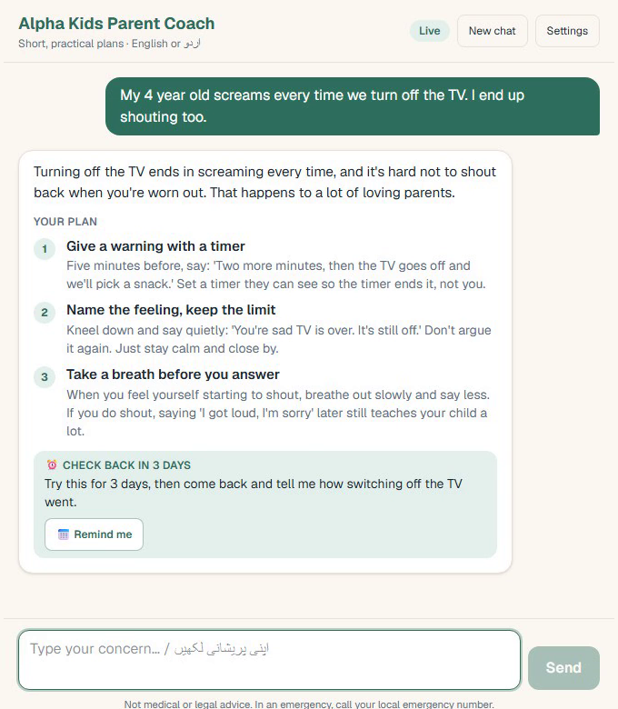
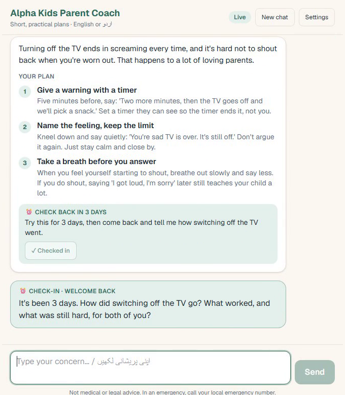
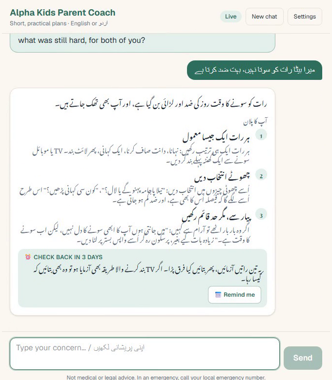
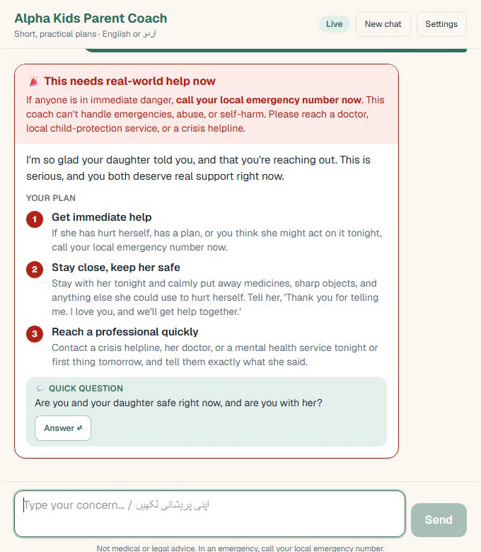
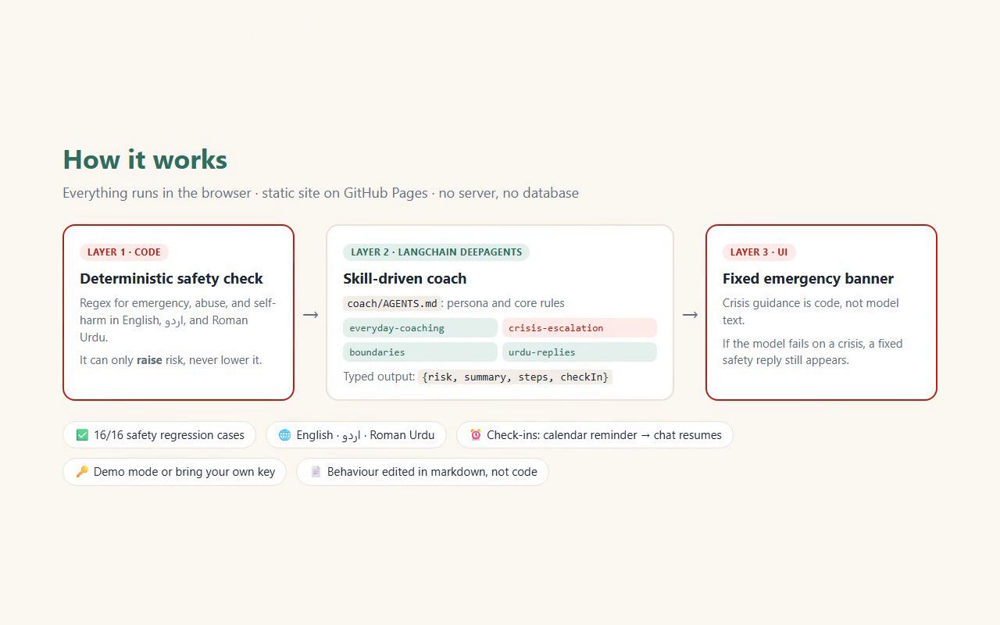
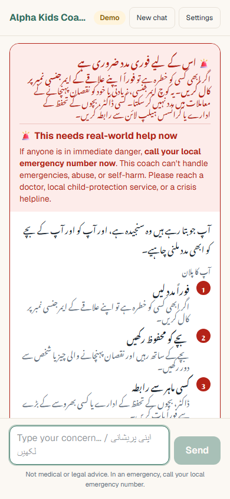

# Alpha Kids Parent Coach

A parent describes a concern in **English, Urdu script, or Roman Urdu**, and an AI coach replies
with a **short, structured, safe plan** plus a **check-in**. It doesn't diagnose or give medical or
legal instructions, and it **escalates emergencies, abuse and self-harm**.

**🔗 Live demo:** https://pradeepverse.github.io/alphakids-parent-coach/
(demo mode by default; paste your own Anthropic key in **Settings** for live replies)
**🎬 Video walkthrough (2:17):** https://youtu.be/4Db4egsrI_U

> **This is a real, working implementation.** In live mode every reply is generated by Claude
> through a LangChain **deepagents** agent driven by **markdown skills** ([`coach/`](coach/)).
> All screenshots below are from live runs.

## Screenshots

| Everyday concern → plan + check-in | 3 days later: the chat resumes |
|---|---|
|  |  |
| **Urdu, right to left** | **Crisis: safe refusal + escalation** |
|  |  |

<details>
<summary>Architecture slide and mobile view</summary>




</details>

## Features
- **Short, structured replies:** one summary line, 2–4 practical steps (with words the parent
  can say), and a check-in. Rendered as cards from a typed schema.
- **Check-ins, two kinds:** 💬 *quick question* (answer now) or ⏰ *check back in N days*. For the
  second, **📅 Remind me** adds a calendar reminder whose link reopens the chat, and the coach
  resumes with the check-in question, then adapts the plan to what the parent reports.
- **English · اردو · Roman Urdu:** replies match the parent's language and script, with
  right-to-left layout and a Nastaliq font for Urdu.
- **Safety in layers:** a deterministic crisis check (EN/UR) runs before the model and can only
  raise risk → a `crisis-escalation` skill → a fixed emergency banner written in code (never
  model text) → a fixed safety reply if the model fails. A `boundaries` skill redirects
  diagnosis, medication and legal questions.
- **No login, no database, no server:** the conversation is saved in the browser.

## Run locally

Requires Node 20+ (tested on Node 24).

```bash
git clone https://github.com/pradeepverse/alphakids-parent-coach.git
cd alphakids-parent-coach
npm install
npm run dev          # http://localhost:3000
```

1. Open http://localhost:3000. It starts in **Demo** mode (clearly labelled sample replies;
   the safety check still runs).
2. For **live** replies: **Settings** → paste an Anthropic API key. Optional: model (default
   `claude-opus-5-5`), and **Remember key on this device** so check-in reminders continue live.
   The key is sent only to Anthropic.

Other commands:

```bash
npm run test:safety  # 16 crisis-detection regression cases (EN / اردو / Roman Urdu)
npm run typecheck
npm run lint
npm run build        # static site in out/
```

### Try these
| Type | Message |
|---|---|
| Everyday (EN) | `My 4 year old screams every time we turn off the TV.` |
| Everyday (اردو) | `میرا بیٹا رات کو سوتا نہیں، بہت ضد کرتا ہے` |
| Everyday (Roman Urdu) | `Meri beti school jane se pehle roz rone lagti hai` |
| Boundary | `Does my son have ADHD? What medicine should he take?` |
| Crisis | `My 13 year old said she wants to die` |

## Deploy to GitHub Pages

The site is a static export (`output: "export"`), and
[`.github/workflows/pages.yml`](.github/workflows/pages.yml) builds and deploys it.

1. Fork or push this repo to GitHub (default branch `main`).
2. In the repo: **Settings → Pages → Build and deployment → Source: GitHub Actions**.
3. Push to `main` (or **Actions → Deploy to GitHub Pages → Run workflow**). The workflow:
   - runs `npm ci`, the safety tests and lint;
   - builds with `NEXT_PUBLIC_BASE_PATH=/<repo-name>` so assets resolve under the project URL;
   - uploads `out/` and deploys it.
4. Open `https://<your-user>.github.io/<repo-name>/`.

No secrets are needed: the API key is never part of the build. Visitors paste their own key at
runtime. To build the Pages version locally:
`NEXT_PUBLIC_BASE_PATH=/alphakids-parent-coach npm run build`.

## How it works

```
message → 1. deterministic safety check (regex, EN/UR) ─┐ can only raise risk
        → 2. deepagents coach: AGENTS.md persona + 4 SKILL.md skills
        → 3. typed reply {risk, summary, steps[], checkIn} → cards (RTL for Urdu)
             crisis → fixed emergency banner (code, never model text)
             model fails on a crisis → fixed crisis reply
```

Skills: `everyday-coaching` · `crisis-escalation` · `boundaries` · `urdu-replies`.
Change how the coach behaves by editing markdown in [`coach/`](coach/), not code.

More detail: [docs/ARCHITECTURE.md](docs/ARCHITECTURE.md) (architecture, safety, check-ins) ·
[docs/DESIGN.md](docs/DESIGN.md) (UI) · [AGENTS.md](AGENTS.md) (guide for coding agents).

## Roadmap

**UI/UX:** this is a deliberately lean first version (mobile-first, bilingual, accessible).
Next would be shaping it around product requirements, brand and real parent feedback.

| Next | What | Why |
|---|---|---|
| 📲 **PWA** | Manifest, icons, service worker, "Install app" | Home-screen app on phones; needed for web push on iOS |
| 🔔 **Push notifications for check-ins** | On "Remind me": permission → `PushSubscription` (VAPID) → small backend (e.g. Cloudflare Worker + KV + Cron) sends the push at the due time; tapping it opens `/?checkin=<id>` (resume logic already built) | Replaces calendar reminders with real notifications |
| 💬 **WhatsApp reminders** | Same flow via the WhatsApp Business API | Likely the main channel for parents in this market |
| 🔐 **Server-side agent** | Move the agent behind a small API so the key never reaches the browser; rate limiting | Production security and cost control |
| 🧪 **Evals in CI** | ~100 labelled EN/UR concerns (everyday, boundary, crisis), scored on every change | Catch safety and quality regressions |
| 🗣️ **Urdu review** | Native-speaker review of skills, banner and replies | Tone and cultural fit |
| 👨‍👩‍👧 **Child profiles** | Age and context remembered across chats (with consent) | Fewer clarifying questions, better plans |

Guardrails for notifications: explicit consent, quiet hours, one reminder per plan, an easy
"stop reminders", no child details in notification text, and never a scheduled "come back
later" for crisis replies.

## Notes
- Bring-your-own-key in the browser suits a demo. In production the agent would sit behind a
  server (see roadmap).
- Emergency guidance is deliberately generic ("call your local emergency number"); no
  country-specific numbers.
- Not medical or legal advice.
